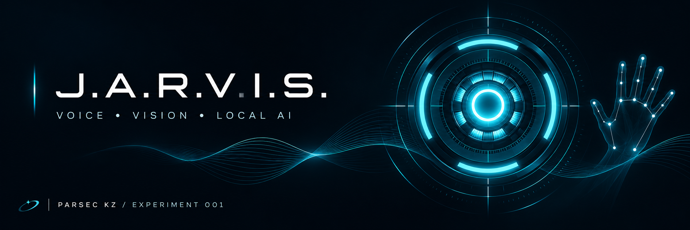
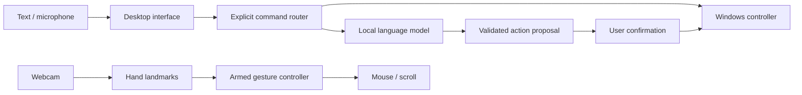

<p align="center"></p>

<p align="center">
  <strong>A movie-inspired idea. A real Windows engineering experiment.</strong><br/>
  Voice commands · Hand tracking · Local inference
</p>

<p align="center">
  
  
  
  
</p>

# J.A.R.V.I.S. / Experiment 001

**Сделал по приколу — захотелось своего Джарвиса.** Потом стало интересно собрать работающую систему: голос, локальную языковую модель, управление Windows и жесты через обычную веб-камеру.

Проект исследует, как соединить несколько моделей и системные API в одном настольном помощнике. Это экспериментальный pet-проект с рабочими модулями, ограничениями и тестами.

[Capabilities](#what-it-does) · [Architecture](docs/ARCHITECTURE.md) · [Quick start](#try-it) · [Operating guide](docs/USAGE.md) · [Authorship](COPYRIGHT.md)

## What it does

| Модуль | Возможности | Технологии |
| :--- | :--- | :--- |
| Voice | Команды с обращением «Джарвис», разовое прослушивание | Vosk · Whisper · sounddevice |
| Vision | Курсор указательным пальцем, щипок для щелчка, прокрутка | MediaPipe · OpenCV · PyAutoGUI |
| Local AI | Диалог и предложение ограниченного набора действий | Qwen2.5 · llama.cpp |
| Windows | Приложения, окна, громкость, заметки, снимки экрана | ctypes · Win32 · SAPI |
| Interface | Анимированный HUD, телеметрия, история сеанса | Tkinter · очереди · рабочие потоки |

## Architecture



**Модель предлагает данные, а не код.** План проверяется по списку разрешённых действий; перед действиями модели появляется подтверждение. Удаление, ввод текста и команды питания также требуют подтверждения. Камера и микрофон включаются вручную.

## Try it

```powershell
git clone https://github.com/isazhannnn/jarvis-for-fun.git
cd jarvis-for-fun
.\setup.cmd
.\start.cmd
```

Нужны Windows x64, Python 3.11+ и интернет для первоначальной загрузки зависимостей и моделей. GPU не обязателен. После установки локальные модели работают на CPU. Доступность голосов зависит от установленных компонентов Windows; дополнительная озвучка `edge` требует сети.

| Команда | Результат |
| :--- | :--- |
| `Джарвис, открой блокнот` | Запуск приложения |
| `Создай заметку: проверить прототип` | Локальная текстовая заметка |
| `Сделай скриншот` | Сохранение в папке проекта |
| `Объясни, что такое процессор` | Ответ локальной модели |

**Жесты:** откройте «Жесты рук» → включите камеру → разрешите управление. Указательный палец двигает курсор; щипок после движения делает щелчок; два пальца управляют прокруткой. Ладонь или кулак ставят действия на паузу. **Esc останавливает камеру.**

## Engineering decisions

- Обработка речи и моделей вынесена из потока интерфейса; события передаются через очереди.
- Распознавание поддерживает 99 языков Whisper, но точность зависит от языка и длины фразы. Для коротких команд лучше выбирать язык вручную.
- Токены подтверждения имеют срок действия и используются один раз.
- Модель диалога не исполняет shell-команды и не получает произвольные инструменты.
- Запасной portable backend речи предусмотрен на случай проблем с Python-зависимостями.
- Файлы перемещаются в корзину приложения с восстановлением без перезаписи существующего файла.

## Verification & limits

```powershell
.\.venv\Scripts\python.exe -m unittest discover -s tests -v
.\.venv\Scripts\python.exe main.py --check
```

При последней проверке: **88 тестов прошли, 1 пропущен** из-за разрешений Windows на создание симлинков. Проверяются маршрутизация, подтверждения, жизненный цикл речи, интерпретация жестов и сохранность файлов. Подставные устройства в тестах не заменяют проверку реальной речи и руки.

Небольшая модель может ошибаться; короткая речь может получить неверный язык. Жестам нужны освещение и видимая рука. Помощник не видит содержимое экрана и не умеет самостоятельно выполнять произвольные задачи в любом приложении. Название — отсылка к фантастике, а не обещание возможностей из фильма.

## Privacy

В Git находятся только исходники, тесты и материалы оформления. Настройки, записи, заметки, снимки экрана, модели, логи и виртуальная среда исключены. Сетевая озвучка передаёт текст ответа провайдеру; локальная обработка речи выполняется на компьютере.

## Authorship

**Parsec KZ · [@isazhannnn](https://github.com/isazhannnn)**

Публичный репозиторий предназначен для знакомства с проектом и оценки портфолио. Это не open-source лицензия: условия использования см. в [COPYRIGHT.md](COPYRIGHT.md). История Git, отметки в исходниках и хеш-манифест позволяют сопоставлять конкретные версии; они не делают авторскую метку неудаляемой.

<sub>Original banner generated with AI. Third-party models and libraries retain their own licenses. Independent fan-inspired experiment; no affiliation with Marvel.</sub>
